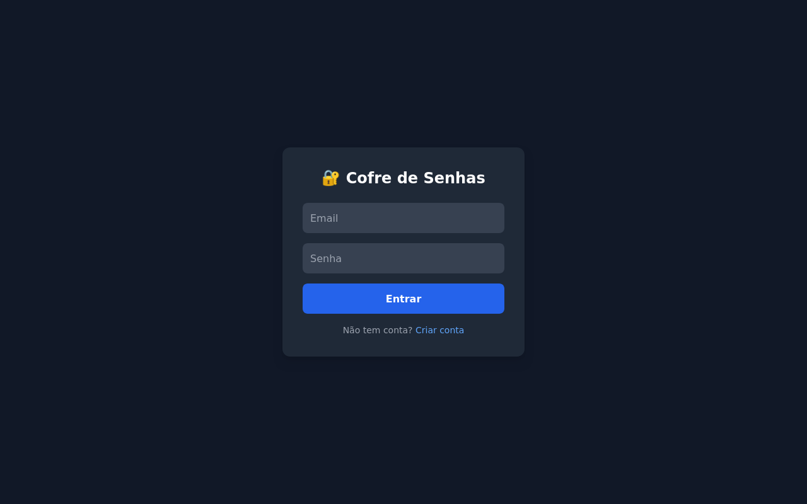
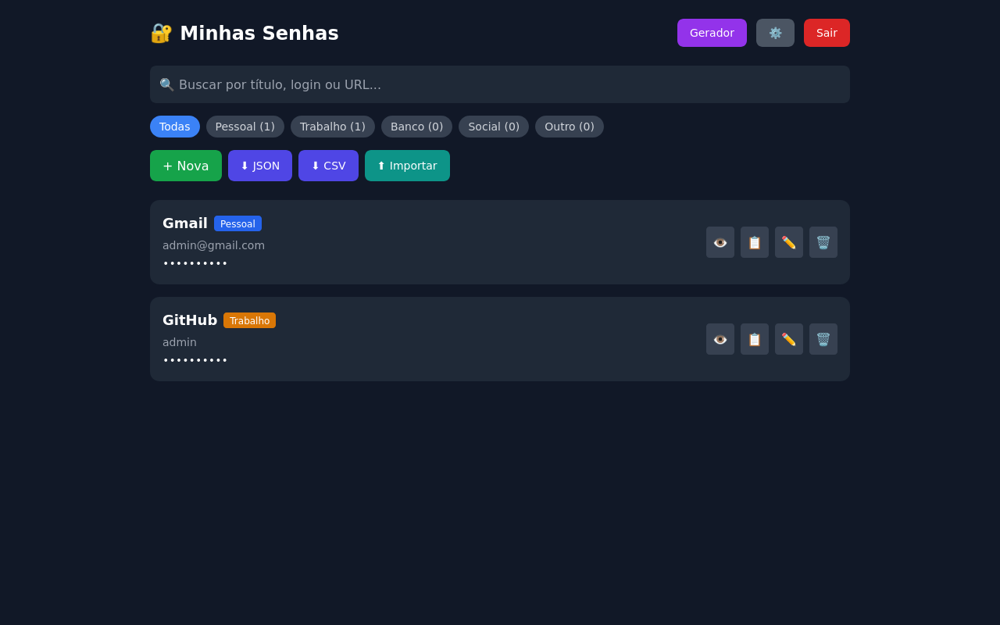
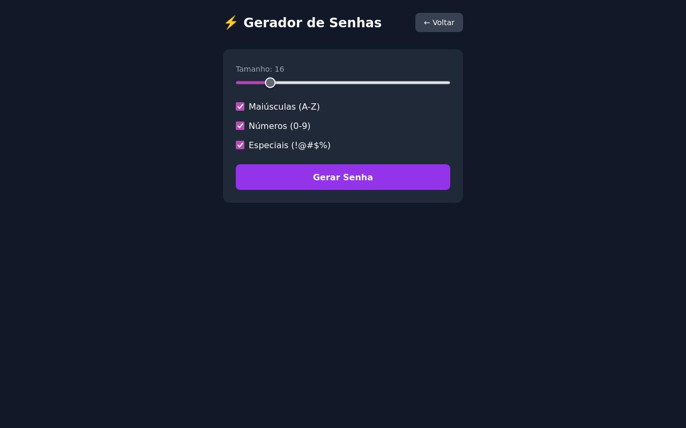

[>] [English](README.en.md) | [Espanol](README.es.md)

# {*} Cofre de Senhas

[](https://github.com/DanielHoffmannO/CofreSenhas/actions)


> Gerenciador de senhas pessoal com criptografia forte, autenticacao 2FA e extensao para browser.
>
> Backend reescrito do zero em Rust idiomatico (era .NET/ASP.NET Core), mantendo o mesmo frontend React e o mesmo contrato de API.

## [~] Screenshots

| Login | Dashboard | Gerador |
|:-----:|:---------:|:-------:|
|  |  |  |

## {=} Tech Stack

| Camada | Tecnologia |
|--------|-----------|
| Front-end | React 18 + TypeScript + Tailwind CSS + Vite |
| Back-end | Rust + axum (Web API) |
| Banco | SQLite (embutido, via rusqlite) |
| Auth | JWT (Bearer Token) + 2FA (TOTP) |
| Criptografia | ChaCha20-Poly1305 (senhas) + Argon2 (senha de conta) |
| Infra | Docker Compose |
| Extensao | Browser Extension (Firefox / LibreWolf) |

## [!] Como Rodar

```bash
cp .env.example .env   # ajuste portas/segredos se necessario
docker-compose up --build
```

| Servico | URL |
|---------|-----|
| Front-end | http://localhost:8080 |
| API | http://localhost:5000/api |
| Health check | http://localhost:5000/health |

> ⚠️ **`JWT_SECRET` e `ENCRYPTION_SECRET` no `.env` precisam ser valores fortes e únicos** (ex.: `openssl rand -base64 48`) antes de guardar senhas de verdade -- os defaults do código são públicos. O `ENCRYPTION_SECRET` deriva a chave que cifra as senhas no banco: **trocá-lo depois de já ter dados salvos torna esses dados ilegíveis para sempre.** Guarde-o em local seguro (gerenciador de senhas, cofre) -- perder o `.env` sem backup é perder o cofre inteiro.

### Backup

O banco é um único arquivo SQLite (volume `api-data` no Docker). `scripts/backup.sh` tira um snapshot consistente (o servidor pode estar rodando), **cifra** (age ou gpg), mantém `RETENCAO_DIAS` (30) e opcionalmente copia para fora do servidor:

```bash
# gpg simétrico (ou AGE_RECIPIENT=age1... para age)
echo 'uma-senha-longa' > ~/.cofre-backup-pass && chmod 600 ~/.cofre-backup-pass
BACKUP_PASSPHRASE_FILE=~/.cofre-backup-pass BACKUP_REMOTE=usuario@outra-maquina:/backups/ ./scripts/backup.sh
```

Agende no cron (`0 3 * * *`) ou num systemd timer. **Teste a restauração** sem tocar no banco real:

```bash
./scripts/restaurar-teste.sh backups/cofre-AAAAMMDD-HHMMSS.db.gpg ~/.cofre-backup-pass
```

> O backup **não** contém o `ENCRYPTION_SECRET`, e sem ele o banco é ilegível. Guarde-o fora do servidor (gerenciador de senhas / papel num cofre), separado do arquivo cifrado. Mantenha o `.env` com `chmod 600`, fora do repositório e do backup.

### Segurança operacional

- **HTTPS**: a extensão e o frontend só devem ser usados via `https://cofre.hoffserv.lan` (proxy com a CA interna). A extensão recusa preencher em páginas `http`.
- **Login**: após 5 falhas seguidas (por e-mail ou IP) há bloqueio com espera crescente (30s até 15min). Estado em memória.
- **Sessão**: JWT de 8h; "Sair" invalida todos os tokens. O frontend encerra a sessão após 15 min de inatividade e limpa a área de transferência 30 s depois de copiar. A extensão guarda o token só na memória.
- **2FA**: ao ativar, são gerados 10 códigos de recuperação de uso único (guardados só como hash, mostrados uma vez).
- **CORS**: só `https://cofre.hoffserv.lan`; ajuste com `CORS_ORIGINS=a,b` no `.env`.

### Sem Docker (dev)

```bash
# API (porta 5000 por padrao)
cargo run --bin server

# Front-end
cd frontend && npm install && npm run dev
```

O front-end (`vite dev`, porta 3000) já tem um proxy configurado para `/api` -> `http://localhost:5000`.

### CLI local (bonus)

Este mesmo binário Rust também expõe uma CLI standalone, single-usuário, sem precisar do servidor web -- útil para uso pessoal via terminal:

```bash
cargo run --bin cofresenhas -- init
cargo run --bin cofresenhas -- add github meu-usuario
```

Veja [`src/cli.rs`](src/cli.rs) e os módulos `crypto`/`storage`/`vault` para detalhes.

## [+] Features

- {k} Login e registro com JWT + Autenticacao 2FA (TOTP)
- {#} Senhas criptografadas em repouso (ChaCha20-Poly1305), com chave derivada do `ENCRYPTION_SECRET` do servidor. **Nao e zero-knowledge:** quem tiver o banco *e* o `.env` consegue ler tudo.
- [w] CRUD completo de senhas
- [*] Gerador configuravel (tamanho, maiusculas, numeros, especiais)
- [|] Indicador de forca (Fraca -> Muito Forte)
- [x] Extensao para browser (Firefox / LibreWolf) com sugestao automatica de preenchimento
- [^] Export/Import (JSON e CSV, com deteccao de duplicata no import)
- [>] Copiar com 1 clique + Mostrar/ocultar
- [~] Interface dark mode responsiva
- [<3] Health check

> Master password separada e historico de versoes existiam no backend .NET original; foram deixados de fora do Rust. O rate limit de login voltou (ver "Seguranca operacional") ao virar o cofre principal.

## {/} Arquitetura

```
src/
+-- lib.rs          <- ponto de entrada da lib compartilhada
+-- bin/
|   +-- server.rs    <- entrada do servidor web (axum)
|   +-- cofresenhas.rs <- entrada da CLI standalone
+-- crypto/          <- Argon2 (hash) + ChaCha20-Poly1305 (cifra) -- usado por CLI e server
+-- storage/, vault.rs, cli.rs  <- CLI local single-usuário
+-- server/          <- API web multiusuário
|   +-- db.rs         <- pool SQLite + schema
|   +-- auth.rs       <- JWT, hash de senha, TOTP
|   +-- models.rs     <- DTOs (mesmo contrato JSON do frontend)
|   +-- handlers/     <- rotas: auth, senhas, gerador
frontend/
+-- React + TypeScript + Tailwind + Vite
extension/
+-- Browser Extension (Manifest V2 -- Firefox / LibreWolf)
```

## [?] Testes

```bash
cargo test
```

## [$] Licenca

Este projeto esta sob a licenca [MIT](LICENSE).
